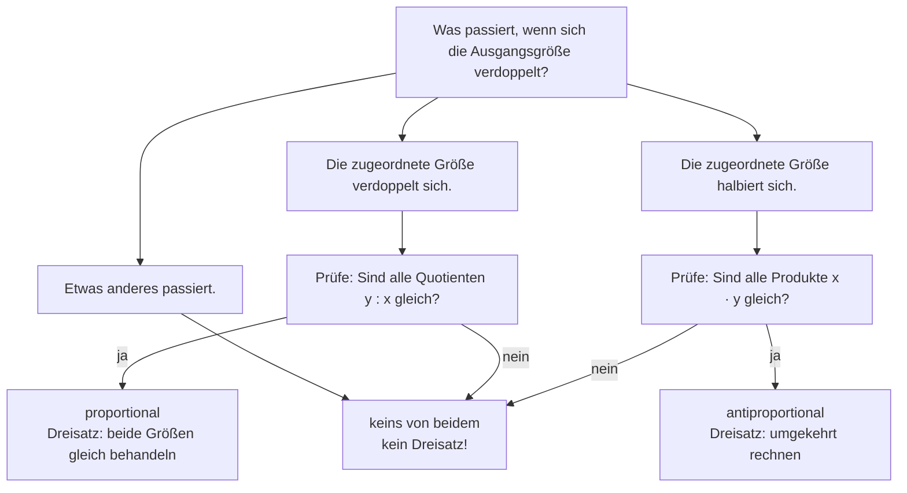

# Das passende Modell wählen

:::alert{info}

📓 **Im Arbeitsheft (S. 34)** findest du Buchaufgaben zum Wählen des passenden Modells. **Hier** bekommst du eine Entscheidungshilfe, übst das Entscheiden an vielen Situationen und lernst, wann ein Modell nicht mehr zur Wirklichkeit passt.

:::

## Die Entscheidungshilfe

Bevor du rechnest, entscheidest du: proportional, antiproportional oder keins von beidem? Folge den Fragen von oben nach unten.

:::snippet{#merken}

**In drei Schritten zum passenden Modell**

1. **Prüfe den Sachverhalt:** Was passiert beim Verdoppeln? „Je mehr – desto mehr“ oder „je mehr – desto weniger“ ist nur ein erster Hinweis.
2. **Prüfe die Zuordnung:** Sind die Quotienten gleich (proportional) oder die Produkte (antiproportional)?
3. **Berechne** die fehlenden Werte mit dem passenden Dreisatz oder mit dem Faktor.

:::

## Welches Modell passt?

:::multievent

| Situation | Modell |
| --- | --- |
| Ein Heft kostet 1,70 €. Anzahl Hefte → Preis | {R1{!proportional}} {R1{antiproportional}} {R1{keins von beidem}} |
| Gleich starke Pumpen leeren einen Pool. Anzahl Pumpen → Zeit | {R2{proportional}} {R2{!antiproportional}} {R2{keins von beidem}} |
| Ein Kind wächst. Alter → Körpergröße | {R3{proportional}} {R3{antiproportional}} {R3{!keins von beidem}} |
| Eine Kerze brennt ab. Brenndauer → Länge der Kerze | {R4{proportional}} {R4{antiproportional}} {R4{!keins von beidem}} |
| Ein Feld wird gleichmäßig bepflanzt. Fläche → Anzahl Pflanzen | {R5{!proportional}} {R5{antiproportional}} {R5{keins von beidem}} |
| Ein Vorrat wird gerecht verteilt. Anzahl Personen → Anteil pro Person | {R6{proportional}} {R6{!antiproportional}} {R6{keins von beidem}} |
| Taxifahrt mit Grundgebühr. Strecke → Preis | {R7{proportional}} {R7{antiproportional}} {R7{!keins von beidem}} |
| Ein Auto fährt eine feste Strecke. Geschwindigkeit → Fahrzeit | {R8{proportional}} {R8{!antiproportional}} {R8{keins von beidem}} |

{h{Stell dir bei jeder Zeile vor, die Ausgangsgröße verdoppelt sich. Was passiert mit der zugeordneten Größe: verdoppelt, halbiert oder etwas anderes?}}

:::

## Erst entscheiden, dann rechnen

:::multievent

**a)** Für 3 Portionen Linsencurry braucht man 3,75 m² Ackerfläche. Wie viel Fläche brauchen 12 Portionen?

Die Zuordnung ist {A{!proportional|antiproportional}}. 12 Portionen brauchen {z{15}} m².

:::

:::multievent

**b)** Ein Acker reicht bei 50 Portionen pro Tag 120 Tage. Wie lange reicht er bei 75 Portionen pro Tag?

Die Zuordnung ist {A{proportional|!antiproportional}}. Der Acker reicht {z{80}} Tage.

:::

:::multievent

**c)** 5 Busfahrkarten kosten 14 €. Wie viel kosten 8 Karten?

Die Zuordnung ist {A{!proportional|antiproportional}}. 8 Karten kosten {z{22,4}} €.

:::

:::multievent

**d)** Mit 4 Rasenmähern ist der Sportplatz in 3 Stunden gemäht. Wie lange dauert es mit 6 Rasenmähern?

Die Zuordnung ist {A{proportional|!antiproportional}}. Es dauert {z{2}} Stunden.

:::

:::multievent

**e)** Mit 10 Jahren ist Ben 1,40 m groß. Wie groß ist er mit 20 Jahren?

Die Zuordnung ist {A{proportional|antiproportional|!keins von beidem}}. Man kann die Größe {A{mit dem Dreisatz berechnen|!nicht mit dem Dreisatz berechnen}}.

:::

## Wann passt das Modell nicht mehr?

Ein Modell ist eine **Vereinfachung** der Wirklichkeit. Es stimmt oft nur in einem bestimmten Bereich. Prüfe deshalb dein Ergebnis immer: Ist es in der Wirklichkeit möglich?

:::multievent

Warum passt das Modell hier nicht mehr? Ordne zu.

- „2 Maler streichen ein Zimmer in 6 Stunden. Also schaffen 120 Maler es in 6 Minuten.“ \
  {A{Zimmer sind verschieden groß.|!So viele Maler passen nicht ins Zimmer und stehen sich im Weg.|Maler arbeiten nicht gern zusammen.}}
- „Ein Becher Joghurt kostet 0,60 €. Also kosten 10 Becher 6 €.“ Im Supermarkt gibt es aber ein 10er-Pack für 4,99 €. \
  {A{!Großpackungen haben oft einen Mengenrabatt.|Der Joghurt ist abgelaufen.|Man hat sich verrechnet.}}
- „36 Bonbons für 5 Kinder: Jedes bekommt 7,2 Bonbons.“ \
  {A{Das Ergebnis ist falsch gerundet.|!Bonbons kann man nicht in Teile brechen.|Die Zuordnung ist proportional.}}

:::

:::alert{warn}

**Typische Fehler**

- **Nur nach „je mehr – desto …“ entscheiden:** Das ist ein Hinweis, kein Beweis. Prüfe die Quotienten oder Produkte.
- **Immer den Dreisatz benutzen:** Bei „keins von beidem“ hilft er nicht. Dann brauchst du andere Informationen, zum Beispiel eine Tabelle oder eine Formel.
- **Das Ergebnis nicht prüfen:** 120 Maler in einem Zimmer oder 7,2 Bonbons pro Kind – frage dich immer, ob das Ergebnis in der Wirklichkeit Sinn ergibt.

:::

:::alert{info}

**Weiter üben:** *Elemente der Mathematik 7*, S. 41, Aufg. 1–3 · S. 42, Aufg. 4–10 · zum Knobeln S. 44, Aufg. 12–16

:::
